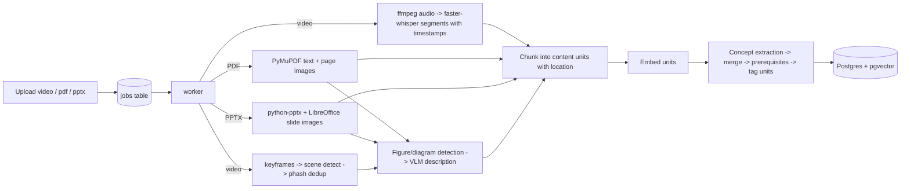

# StudyGraph — Project Ground Truth

> **Working title:** StudyGraph — a source-grounded, misconception-aware AI study companion that turns lecture videos, textbooks and slides into a cited concept graph, then tutors and assesses each student against it.
> **Event:** Multimodal AI Hackathon 2026 (Devpost)
> **Track:** Track D — Personalized Tutoring & Adaptive Learning
> **Doc version:** 1.1 — 2026-10-12 (v1.1: AI provider is NVIDIA NIM; hosting is an Oracle Cloud Always Free VM (arm64); demo course fixed to MIT OCW 6.041SC)
> **Status:** Ground truth for the MVP build. If code and this document disagree, this document wins unless an ADR in `docs/decisions/` amends it.

---

## 0. How to use this document

### 0.1 For the human (you)

1. Put this file at the repo root as `PROJECT.md`.
2. Put the short `AGENTS.md` from **Appendix A** next to it (opencode reads `AGENTS.md` automatically).
3. Work **one phase at a time** (Section 15). For each phase, paste the prompt template from **Appendix B** into the agent.
4. At the end of every phase, review the evidence the agent wrote to `docs/verification/phase-N.md` **before** letting it start the next phase.
5. Resolve the open items in **Section 4** yourself in Phase 0 (they need the live Devpost page and your own decisions). The agent cannot see them.

### 0.2 For the agent

- This document is the specification. Read it fully before writing any code. Re-read the current phase section and Sections 13–14 at the start of every phase.
- Implement **only the current phase**. Do not pre-build later phases.
- Do not invent requirements. If something is ambiguous, follow the documented default; if there is none, write the question to `docs/questions.md`, pick the simplest option consistent with this document, and continue.
- Every phase ends with a **Verification Gate**. You may not declare a phase complete until the gate evidence exists in `docs/verification/phase-N.md` with **real pasted command output**.
- After every completed feature, run `make verify` and then **commit using Conventional Commits** (Section 14.3). Never skip hooks (`--no-verify` is forbidden).
- Tests and CI must never download large models or call paid APIs. Use the mock backends defined in Section 16.2.

### 0.3 Source-of-truth hierarchy

1. `docs/decisions/*.md` (ADRs) — latest accepted ADR wins.
2. This document (`PROJECT.md`).
3. `README.md`.
4. Code comments.

Any deviation from this document must be recorded as an ADR (template in Appendix C) **before** the deviating code is committed.

---

## 1. Product definition

### 1.1 One-liner

A web app where a student uploads their course videos, textbook and slides; the system builds a **cited concept graph** from them, answers questions **only from that material** (flagging or refusing everything else), generates **verified, misconception-tagged quizzes**, and keeps a **per-concept learner model** that decides what to teach and ask next, with measured evidence that the personalization works.

### 1.2 Problem

Students study from lecture videos, textbooks and slides scattered across places. General chatbots answer confidently but are not tied to the course material or to what the student already understands, so answers can be wrong for the course and study time is spent on topics the student already knows. Existing "chat with your PDF" tools stop at text retrieval: they ignore video and diagrams, do not model prerequisites, generate unverified quiz questions and do not measure whether they help.

### 1.3 Target users

| User | Need |
| --- | --- |
| Undergraduate student studying for an exam | Trustworthy answers tied to *their* course, quizzes on a scope they choose, and a clear picture of weak topics |
| Self-learner using open courses (MIT OCW, NPTEL) | One place for lectures + readings, with jumps to the exact timestamp, page or slide |
| Instructor / evaluator | Evidence that answers are grounded, questions are correct, and personalization measurably improves outcomes |

### 1.3.1 Core example (used in the demo; the demo course is MIT OCW 6.041SC probability, see Section 5.2)

Aarav uploads lecture videos, the matching lecture PDFs and one textbook chapter on probability. StudyGraph ingests them without manual steps and shows a concept map. He takes a 10-question diagnostic; the map turns red/amber/green. He asks "why does X work?" and gets an answer with citations that open lecture 2 at 14:32 and slide 18. He asks an off-topic question and the tutor says the material does not cover it. He takes a quiz; a wrong answer is traced to a named misconception and then to a weak prerequisite, and the tutor explains that first with a cited source. Over several sessions, the map turns green and the report shows measured gains.

### 1.4 Product principles (non-negotiable)

1. **Source first.** Every factual statement in a tutor answer is labelled `source_backed`, `outside_knowledge` or `not_covered`. Only `source_backed` text carries citations.
2. **Citations are resolved by the server, never typed by the model.** The LLM may only reference `unit_id`s it was given. Page/slide/timestamp shown to the user always come from the stored content unit. No fabricated locations.
3. **Every citation opens the exact location** (PDF page, slide image, video at timestamp).
4. **Only verified questions reach the student.** A question that fails verification is discarded, never shown.
5. **The learner model is explainable.** Every adaptive choice stores a human-readable reason ("why this question?").
6. **Measured, not claimed.** Any number in the README, video or Devpost must be reproducible from `eval/` scripts and copied from `docs/verification/eval-results.md`. Simulated-student results are always labelled as simulated.
7. **Graceful degradation.** If the LLM is unavailable, the app still shows retrieval-only excerpts and existing mastery data; it never invents an answer.
8. **Honest limits.** Report weaknesses and failure cases in the docs.

### 1.5 Mandatory disclaimers (UI and README)

- "Answers are generated from the material you uploaded and can contain errors. Check the cited source."
- "Content marked 'Outside your material' is general AI knowledge, not from your course."
- "Simulated-student results are simulations, not results from real learners."
- Only upload material you have the right to use. The demo course is openly licensed with attribution.

### 1.6 Non-goals (MVP)

Accounts/passwords, instructor console, multi-tenant orgs, native apps, real-time collaboration, grading for credit, LMS integration, certificate/credential features, handwriting recognition, live-class capture. See **Section 20 (Future scope)**.

---

## 2. Track alignment, judging strategy, differentiation

### 2.1 Official evaluation criteria → what we ship

| Criterion (weight) | What earns points | Where it is built |
| --- | --- | --- |
| Knowledge Base & Grounding (20%) | Multimodal extraction, source links preserved, citation accuracy, correct refusal | Phases 2–5, Section 8 |
| Assessment Quality (15%) | Correct, novel, tagged questions; useful feedback and reports | Phase 6, Section 9 |
| Personalization Effectiveness (20%) | Learner-model approach, measurable gains in simulated runs, responsive tutor | Phases 7–8, Sections 10–11 |
| UX & Demo Video (15%) | Dashboard clarity, workflow, optional features | Phases 7, 9, Section 12 |
| System Evaluation (15%) | Framework (RAGAS), metrics, test-set quality, honest reporting | Phase 8, Section 11 |
| Technical Implementation (15%) | Code quality, architecture, CI | All phases, Sections 6, 13, 14, 18 |

### 2.2 Differentiation (designed in, not added at pitch time)

Typical submissions: chunk-and-embed PDFs, page-number citations, a single-LLM quiz generator, a mastery percentage, and a screenshot of RAGAS scores. StudyGraph differs:

| Typical | StudyGraph |
| --- | --- |
| Flat vector store over text | **Cited concept graph** with prerequisites; every unit tagged to concepts and linked to its origin |
| Page-number citations | **Server-resolved citations that open the exact page, slide or video timestamp** |
| Refuses only when retrieval is empty | **Per-sentence labels + verifier**; refusal measured on an **adversarial off-material benchmark** (near-miss, false-premise) |
| Quizzes "checked" by the same LLM | **Verified questions**: executed numericals, cross-model solving, dedup; verification pass rate reported |
| Generic distractors | **Misconception-tagged distractors**: a wrong choice names the misconception and cites the correcting source |
| "Multimodal" = text only | **Figure-dependent questions** that need a diagram, with a figure-necessity check |
| Mastery as a percentage | **BKT per concept + prerequisite propagation + forgetting**; wrong answers traced to the root prerequisite |
| Claimed personalization | **Ablation**: adaptive vs random vs sequential on simulated students, with confidence intervals and failure cases |

### 2.3 The "wow" moment (demo centerpiece)

A **Knowledge Map** that is both the course and the student: prerequisite graph coloured by mastery. A wrong quiz answer triggers a visible trace: *chosen distractor → named misconception → weak prerequisite → "watch Lecture 3, 14:32–16:10 and read p. 212"*, all citations clickable. Pair it with a 20-second side-by-side: a general chatbot hallucinates an off-course answer, StudyGraph says "not covered in your material".

### 2.4 Impact statement (reuse in Devpost)

Trust (students can verify any claim against their own material), efficiency (study time goes to root-cause gaps), accessibility (works from whatever the student already has, no instructor setup), and rigor (every claim about quality is backed by a reproducible evaluation).

---

## 3. MVP scope

### 3.1 Priority levels

- **P0** — must ship (the demo is invalid without it). ★ marks the differentiators that carry the pitch.
- **P1** — should ship; cut if time-boxed.
- **P2** — nice to have; only if everything else is done.

### 3.2 Feature list

| ID | Feature | Priority | Phase |
| --- | --- | --- | --- |
| F-01 | Ingest PDF textbook and slide decks (PDF/PPTX) with page/slide locations, no manual preprocessing | P0 | 2 |
| F-02 | Figure/diagram extraction with VLM descriptions linked to page/slide | P0 | 2 |
| F-03 | Ingest lecture video: ASR with timestamps + keyframe/slide-frame descriptions | P0 | 3 |
| F-04 | Unified content units, each with source + exact location | P0 | 2–3 |
| F-05 | Concept graph: topics → subtopics → concepts, prerequisite edges, unit tagging | P0 | 4 |
| F-06 | Grounded tutor chat with citations that open exact location | P0 | 5 |
| F-07 | ★ Three-way answer labels + verifier + correct refusal | P0 | 5 |
| F-08 | Quiz/mock exam generation (MCQ, short answer, numerical) on chosen scope, tagged by topic, source, difficulty | P0 | 6 |
| F-09 | ★ Question verification (executed numericals, cross-model solving) + dedup | P0 | 6 |
| F-10 | ★ Misconception-tagged distractors and likely-misconception report | P0 | 6 |
| F-11 | ★ Figure-dependent questions | P0 | 6 |
| F-12 | Cited per-answer feedback + post-assessment report (weak topics) | P0 | 6 |
| F-13 | Learner model: BKT per concept, prerequisite propagation, forgetting decay | P0 | 7 |
| F-14 | Diagnostic quiz / cold start | P0 | 7 |
| F-15 | ★ Adaptive selection with "Why this question?" explanation | P0 | 7 |
| F-16 | ★ Knowledge Map colored by mastery + dashboard | P0 | 7 |
| F-17 | RAGAS evaluation on team-built test set + custom citation accuracy and refusal metrics | P0 | 8 |
| F-18 | ★ Adversarial refusal benchmark (near-miss, false premise, figure-only) | P0 | 8 |
| F-19 | ★ Simulated-student ablation (adaptive vs random vs sequential) | P0 | 8 |
| F-20 | ★ Eval-in-CI regression gate + one-command Docker setup | P0 | 8–9 |
| F-21 | Ingestion quality flags (low ASR confidence, empty OCR/figure) | P1 | 9 |
| F-22 | Study schedule from weak topics, forgetting curves and exam date | P1 | 9 |
| F-23 | Revision flashcards for weak concepts (source-cited) | P2 | — |
| F-24 | Hindi/mixed-language explanation toggle (outside-source translation flagged) | P2 | — |
| F-25 | Audio/voice tutoring session | P2 | — |
| F-26 | Teach-back mode (student explains, system grades against graph) | P2 | — |

### 3.3 Definition of "MVP complete"

A stranger can open the deployed URL (or run `docker compose up`), see a pre-ingested demo course, ask a question and click a citation that opens the exact timestamp/page/slide, ask an off-material question and get a correct refusal, take a diagnostic, watch the Knowledge Map update, take an adaptive quiz with a misconception-tagged wrong answer and cited feedback, and open an evaluation page with reproducible RAGAS and simulated-student results.

---

## 4. Working assumptions and open questions (resolve in Phase 0)

These need the live Devpost page, the organizers, or your own decision. Record outcomes in `docs/questions.md` and ADRs.

| # | Assumption / question | Default if unresolved |
| --- | --- | --- |
| A-1 | Submission deadline and time zone (not known to this spec) | Read it from the Devpost dashboard on day 0; convert to IST; plan backward from it |
| A-2 | Team vs individual requirement and registration status | Check the Rules tab; register a team if required |
| A-3 | Required demo-video host and length | Public YouTube video, 3–10 minutes (from the problem statement) |
| A-4 | Rules on originality, build period and AI-assisted coding disclosure | Keep an honest commit history; disclose AI-assisted development in README |
| A-5 | Which course material to use | **Fixed:** MIT OCW 6.041SC (Fall 2013) + OpenStax Introductory Statistics 2e (Section 5.2). Phase 0 only verifies availability, licence and lecture selection |
| A-6 | Compute for ASR and embeddings | Oracle Always Free VM, arm64, CPU only (about 2 OCPU / 12 GB; confirm current limits). `faster-whisper` small model; pre-ingest the demo course |
| A-7 | LLM/VLM provider | **NVIDIA NIM.** The human supplies the key and screenshots of the models available to them; the agent selects models from those screenshots (Section 5.3) |
| A-8 | Public hosting target | **Oracle Cloud Always Free VM** running the full Docker Compose stack (web, api, worker, db). Hosting must cost $0. The human provisions the VM |
| A-9 | Whether Hindi/Indian-language support is in scope | Out of scope for MVP (F-24 is P2) |

---

## 5. Technology stack and demo material

### 5.1 Stack

Use the latest stable versions at build time and record them in `docs/decisions/ADR-0002-versions.md`.

| Layer | Choice | Why | Alternative |
| --- | --- | --- | --- |
| Frontend | Next.js (App Router) + TypeScript (strict), Tailwind, shadcn/ui | Fast UI assembly, accessible primitives | SvelteKit |
| Graph viz | Cytoscape.js (or React Flow) | Interactive node coloring, click-through | D3 |
| Charts | Recharts | Quick | CSS bars |
| PDF viewer | `react-pdf` / PDF.js, opens at `?page=N` | Exact-page citations | iframe |
| Video | HTML5 `<video>` with `currentTime` seek (local files) | Exact-timestamp citations | YouTube iframe API (P2) |
| Backend | Python 3.12, FastAPI, Pydantic v2, SQLAlchemy 2, Alembic, `uv` | Best ML/ingestion ecosystem | — |
| Jobs | DB-backed job table + separate `worker` process | Long ASR/VLM jobs; no extra broker | Celery/RQ |
| DB | PostgreSQL + `pgvector` (Docker) | Relational + vector in one store | SQLite + FAISS |
| ASR | `faster-whisper` (model size via env) | Timestamps, runs on CPU, multilingual | cloud ASR |
| PDF/slides | PyMuPDF (PDF), `python-pptx` (text/notes), LibreOffice headless (PPTX → PDF/PNG) | Text + page/slide images | — |
| Video frames | `ffmpeg` + PySceneDetect or ffmpeg scene filter + perceptual-hash dedup | Slide-frame extraction | — |
| Embeddings | Decided in Phase 0 (ADR-0005): a NIM-hosted embedding model if the human's model list has one, otherwise a small local model (`sentence-transformers` or an ONNX embedder) that has an arm64 build. Tests use the hash backend | Keeps the VM light; avoid heavy local models on 12 GB / 2 OCPU | API embeddings |
| LLM/VLM | Provider interface; default **NVIDIA NIM** (hosted models, called over HTTP); a second, different NIM model for verification; Mock for tests | Free-tier friendly, vision-capable models available, cross-model validation | any OpenAI-compatible endpoint |
| Evaluation | RAGAS (pinned version) + custom metrics; judge model ≠ generator model | Standard framework required by the PS | DeepEval, TruLens |
| Python quality | ruff, mypy (strict on `domain/`), pytest, pre-commit | — | — |
| Web quality | ESLint, Prettier, Vitest, Playwright | — | — |
| Commits | commitlint + husky (web) and pre-commit (python) | Enforce Conventional Commits | — |
| CI | GitHub Actions | Free for public repos | — |
| Packaging | Docker Compose: `web`, `api`, `worker`, `db`; **multi-arch images (amd64 + arm64)** | One-command run; the free Oracle VM is arm64 | — |
| Hosting | Oracle Cloud Always Free VM (arm64) running the compose stack; free TLS via a reverse proxy or Cloudflare Tunnel (decided in Phase 9) | $0, runs live ingestion | Local compose + Cloudflare Tunnel |

### 5.2 Demo course material (fixed; Phase 0 verifies and records it in ADR-0004)

**Course (video + lecture PDFs):** MIT OpenCourseWare 6.041SC, *Probabilistic Systems Analysis and Applied Probability*, Fall 2013, Prof. John Tsitsiklis.
- Course page: https://ocw.mit.edu/courses/6-041sc-probabilistic-systems-analysis-and-applied-probability-fall-2013/
- Unit I (Lectures 1–7): https://ocw.mit.edu/courses/6-041sc-probabilistic-systems-analysis-and-applied-probability-fall-2013/pages/unit-i/
- Example lecture PDF (Lecture 1): https://ocw.mit.edu/courses/6-041sc-probabilistic-systems-analysis-and-applied-probability-fall-2013/ff296575da32c406c2e56131e1e38997_MIT6_041SCF13_L01.pdf
- Licence per the OCW footer: CC BY-NC-SA 4.0 (confirm on the fetched pages). OCW labels the lecture PDFs "Lecture Notes"; Phase 0 records whether they are slide-style or notes. Both are handled by the PDF pipeline with `page` locations.

**Textbook modality:** OpenStax *Introductory Statistics 2e* (https://openstax.org/details/books/introductory-statistics-2e), the chapters on probability topics and discrete random variables. Phase 0 confirms the licence (expected CC BY 4.0), the chapter list and that the topics match. If it is a poor match, the agent proposes one alternative open textbook and asks the human.

**Scope:** 3–4 lectures from Unit I (about 3 hours of video at most) forming one coherent chain: sample space and axioms → conditional probability and Bayes → independence → counting or discrete random variables, paired with their lecture PDFs and the matching textbook chapter(s).

**Why this course:** probability has well-known misconceptions (good for misconception-tagged distractors), numerical answers that the restricted evaluator can verify, a clean prerequisite chain, and figures (Venn diagrams, tree diagrams, PMFs).

Rules: attribution is recorded in `data/demo-course/ATTRIBUTIONS.md` (title, author, licence, URL, changes made, NC-SA/BY notice). Videos are obtained through OCW's own download option, never by scraping YouTube. Do not commit media files; commit `scripts/fetch_demo_course.sh` and checksums. The team must be able to write correct questions about the material (required for the test set). Do not swap the course without asking the human.

### 5.3 Notes and constraints

- **AI provider is NVIDIA NIM.** Model IDs are configuration, not code: `LLM_PROVIDER` (`nim` | `mock`), `NIM_BASE_URL`, `LLM_MODEL`, `VISION_MODEL`, `VERIFIER_MODEL`, `JUDGE_MODEL`, plus an embedding setting. Never guess a model ID or endpoint.
- **How models are chosen (Phase 0, Step 3):** the human uploads screenshots of the models available to their NIM account and shares the API key. The agent reads the screenshots, writes the available models and their stated capabilities into ADR-0005, and selects: a general chat model (`LLM_MODEL`), a **vision-capable** model (`VISION_MODEL`) for figures, a **different** model for cross-model verification (`VERIFIER_MODEL`), a **judge** model for evaluation that differs from the generator (`JUDGE_MODEL`), and an embedding approach. If a required capability (vision, structured output, a second distinct model) is missing from the screenshots, the agent says so and asks before proceeding. Capabilities not visible in the screenshots must be checked in the NIM docs via webfetch, not assumed.
- **Structured output on NIM:** forced tool use may not be available on every NIM model. Use the model's supported JSON-schema / guided-JSON mode if it exists; otherwise prompt with the schema, validate with Pydantic, and retry once on validation failure (retry rules: Phase 1, task 4). Record which mode each model uses in ADR-0005.
- **Rate limits:** NIM free access may be rate limited. Make requests-per-minute, concurrency and backoff configurable (`LLM_RPM`, `LLM_CONCURRENCY`), cache LLM responses by input hash during ingestion and evaluation, and keep tests on the mock provider.
- **API key handling:** the key lives only in `.env` or `.env.local` (gitignored) and in the deployment environment. The agent never prints it, never writes it into any committed file, doc, ADR, log or verification output, and never passes it on a command line that is recorded. The human should rotate the key after the hackathon.
- **Live ingestion on the hosted demo is limited to small files.** The VM has limited CPU. The demo course is pre-ingested. The video shows live ingestion of one short clip (30–120 s) and one PDF. State this in the README.
- **No secrets in the client bundle.** Only `NEXT_PUBLIC_*` variables reach the browser and none may be a secret.
- **Never execute LLM-generated code.** Numerical answers use a restricted arithmetic expression evaluator (whitelisted AST: numbers, `+ - * / ** ( )`, `sqrt exp log sin cos tan pi e` and named variables). No `exec`/`eval`/imports.

---

## 6. Architecture

### 6.1 Layers

```
Browser (Next.js)
  ├─ Library & ingestion status
  ├─ Tutor chat  ──► citations ──► Source viewer (PDF page / slide image / video @ time)
  ├─ Quiz runner & report
  └─ Knowledge Map & dashboard
        │ HTTP/JSON
FastAPI (services/api/app/api)        ← thin routers: validate (Pydantic), call services
        │
Services
  ├─ ingestion/   pdf, pptx, video pipelines → content units (+ figure descriptions)
  ├─ kb/          embeddings, retrieval, concept extraction, prerequisite edges, tagging
  ├─ tutor/       retrieval → generation → verifier → labelled, cited answer
  ├─ assess/      question generation, verification, dedup, feedback, report
  ├─ learner/     BKT, propagation, forgetting, selection policy, scheduling
  ├─ llm/         provider interface + nim/mock, structured output, retries, rate limiting
  ├─ eval/        RAGAS runner, custom metrics, student simulator, ablation
  └─ workers/     DB-backed job runner
Domain (services/api/app/domain)       ← pure: types, BKT math, scoring, citation model, rules
Postgres + pgvector                    ← only repositories in app/db touch SQL
```

**Dependency rule:** `domain` imports nothing from other app packages and performs no I/O. Services import `domain` and `db`. Routers import services. `web` talks to `api` only over HTTP.

### 6.2 Ingestion flow



### 6.3 Tutor answer flow

```mermaid
sequenceDiagram
  participant V as Student
  participant API as API
  participant KB as Retrieval
  participant L as LLM
  participant VR as Verifier
  V->>API: question (+ allow_outside flag)
  API->>KB: hybrid retrieve top-k units (+ concept neighbours)
  KB-->>API: units with ids + locations + scores
  API->>L: question + units (only unit_ids as citable handles)
  L-->>API: segments [{text,label,unit_ids}]
  API->>VR: check each source_backed segment against cited units
  VR-->>API: supported / unsupported per segment
  API->>API: downgrade or drop unsupported; resolve unit_ids -> locations
  API->>API: if no supported segments -> not_covered response
  API-->>V: labelled answer + clickable citations
```

### 6.4 Key design decisions (record as ADRs in Phase 0/1)

| ADR | Decision |
| --- | --- |
| ADR-0001 | Monorepo: `apps/web` (Next.js) + `services/api` (FastAPI) + `eval/`; Docker Compose for local and demo |
| ADR-0002 | Dependency and runtime versions |
| ADR-0003 | Postgres + pgvector; DB-backed job queue and worker process; hosting on an Oracle Cloud Always Free arm64 VM |
| ADR-0004 | Demo course selection and licensing (MIT OCW 6.041SC + OpenStax) |
| ADR-0005 | NVIDIA NIM as provider: model list from the human's screenshots, chosen models per role, structured-output mode per model, embedding approach, rate limits, mock for tests |
| ADR-0006 | Citations are server-resolved from `unit_id`; the LLM never emits locations |
| ADR-0007 | Learner model: BKT + prerequisite propagation + forgetting; constants in config |
| ADR-0008 | Evaluation: RAGAS + custom metrics; CI gate on retrieval/citation/refusal fixtures only |

---

## 7. Domain model

### 7.1 Core entities

- **Course**: a set of sources about one subject.
- **Source**: one uploaded file (`video`, `pdf`, `pptx`), with original file stored.
- **ContentUnit**: smallest citable piece of content. `kind` ∈ `text | transcript | figure | slide_text | ocr`. Has `text`, optional `figure_description`, embedding, and a **Location**.
- **Location**: exactly one of `page` (PDF, int), `slide` (PPTX/slides, int), or `t_start_s`/`t_end_s` (video, float seconds). Also `source_id`. Display string and deep link are derived (`/source/{source_id}?page=12`, `?slide=14`, `?t=872`).
- **Concept**: `level` ∈ `topic | subtopic | concept`, `parent_id`, `name`, `summary`.
- **ConceptEdge**: `prerequisite_id → concept_id`, `weight` ∈ (0,1], `evidence_unit_ids`.
- **Misconception**: `concept_id`, `label`, `description`, `origin` ∈ `source_anchored | llm_suggested`, `evidence_unit_ids`.
- **Question**: type `mcq | short_answer | numerical`; `concept_id`, `difficulty` ∈ `easy | medium | hard`, `source_unit_ids`, answer key, rubric, `requires_figure`, verification record.
- **MasteryState**: per (student, concept): `p_mastery`, `stability_days`, `last_seen_at`, counts.
- **Attempt/Response**: a student's answer with correctness score, chosen distractor, misconception hit.

### 7.2 Tables (SQLAlchemy models; Alembic migrations)

All IDs are UUID v4; timestamps UTC.

| Table | Key columns |
| --- | --- |
| `courses` | `id`, `title`, `description`, `created_at`, `is_demo` |
| `sources` | `id`, `course_id`, `kind`, `filename`, `path`, `sha256`, `duration_s` NULL, `page_count` NULL, `status` (`queued|processing|ready|failed`), `error` NULL, `quality_json` NULL, `license_note` NULL, `created_at` |
| `content_units` | `id`, `source_id`, `kind`, `text`, `figure_description` NULL, `page` NULL, `slide` NULL, `t_start_s` NULL, `t_end_s` NULL, `image_path` NULL, `embedding` vector, `token_count`, `confidence` NULL, `created_at` — CHECK exactly one location form |
| `concepts` | `id`, `course_id`, `parent_id` NULL, `level`, `name`, `summary`, `importance` REAL |
| `concept_edges` | `id`, `course_id`, `prerequisite_id`, `concept_id`, `weight`, `evidence_json` |
| `unit_concepts` | `unit_id`, `concept_id`, `score` — top-k per unit |
| `misconceptions` | `id`, `concept_id`, `label`, `description`, `origin`, `evidence_json` |
| `students` | `id`, `course_id`, `display_name` NULL, `created_at` (anonymous; cookie ID) |
| `mastery_states` | `student_id`, `concept_id`, `p_mastery`, `stability_days`, `last_seen_at`, `n_correct`, `n_incorrect` — PK(student, concept) |
| `questions` | `id`, `course_id`, `type`, `stem`, `options_json` NULL, `answer_key_json`, `rubric_json` NULL, `solution_expression` NULL, `explanation`, `concept_id`, `difficulty`, `source_unit_ids_json`, `requires_figure` BOOL, `figure_unit_id` NULL, `stem_hash`, `embedding` vector, `verification_json`, `created_at` |
| `assessments` | `id`, `student_id`, `course_id`, `mode` (`diagnostic|quiz|mock_exam|adaptive`), `scope_json`, `status`, `created_at`, `finished_at` NULL |
| `assessment_items` | `id`, `assessment_id`, `question_id`, `position`, `selection_reason` TEXT, `mastery_before` REAL NULL |
| `responses` | `id`, `assessment_item_id`, `student_id`, `response_json`, `score` REAL, `is_correct` BOOL, `chosen_misconception_id` NULL, `feedback_json`, `time_ms`, `created_at` |
| `chat_sessions` / `chat_messages` | session and messages; message stores `segments_json`, `labels`, `retrieved_unit_ids`, `verifier_json`, `latency_ms` |
| `chat_signals` | `student_id`, `concept_id`, `kind` (`reask|check_answer`), `created_at` |
| `jobs` | `id`, `kind`, `payload_json`, `status`, `progress`, `error`, `attempts`, `created_at`, `updated_at` |
| `eval_runs` | `id`, `kind`, `config_json`, `results_json`, `created_at` |

### 7.3 HTTP API contract

JSON. Errors: `{ "error": { "code": string, "message": string, "details"?: unknown } }` with correct status. Validate inputs with Pydantic at the router boundary.

| Method & path | Purpose |
| --- | --- |
| `GET /api/health` | Liveness + DB + config presence (no secrets, no LLM call) |
| `POST /api/courses` / `GET /api/courses/{id}` | Create/read course |
| `POST /api/courses/{id}/sources` | Multipart upload (`video|pdf|pptx`), creates `queued` source + job |
| `GET /api/jobs/{id}` | Job status/progress |
| `GET /api/sources/{id}` | Source metadata + quality flags |
| `GET /api/sources/{id}/file` | Stream original (supports HTTP Range for video) |
| `GET /api/sources/{id}/page/{n}` | Page or slide image (PNG) |
| `GET /api/units/{id}` | Content unit with resolved location + deep link |
| `GET /api/courses/{id}/graph` | Concepts, edges, and (if `student_id`) mastery colors |
| `POST /api/students` | Create anonymous student (sets cookie) |
| `POST /api/courses/{id}/chat` | Ask a question → labelled, cited answer. Body: `session_id`, `message`, `allow_outside` |
| `POST /api/courses/{id}/assessments` | Create assessment: `mode`, `scope` (`all|topic_ids|concept_ids`), `n`, `types` |
| `GET /api/assessments/{id}` | Items so far (no answer keys before answering) |
| `POST /api/assessments/{id}/answers` | Submit a response → cited feedback + updated mastery |
| `POST /api/assessments/{id}/finish` | Final report |
| `GET /api/students/{id}/mastery` | Per-concept mastery (+ effective mastery) |
| `GET /api/students/{id}/schedule` | Study schedule (P1) |
| `GET /api/eval/latest` | Latest stored eval summary for the eval page |

---

## 8. Knowledge base and grounding

### 8.1 Content units

- **PDF/textbook:** per page, extract text blocks (PyMuPDF). Chunk into units of about 200–400 tokens **within a page** (never cross page boundaries so every unit has one page). Render each page to PNG for the viewer.
- **Slides:** convert PPTX to PDF/PNG with LibreOffice headless. One unit group per slide: `slide_text` (title + body + speaker notes) and, where figures exist, a `figure` unit. Slide PDFs are handled like PDFs with `slide = page`.
- **Video:** extract audio (ffmpeg) → `faster-whisper` segments with timestamps. Merge segments into windows of about 30–60 s (sentence-aligned) = `transcript` units with `t_start_s/t_end_s`. Extract keyframes on scene change, dedupe by perceptual hash, and send frames that contain slides/diagrams through the VLM to produce `figure` or `ocr` units at the frame's timestamp.
- **Figures:** detect images/diagrams on pages and slides (PyMuPDF image blocks, or whole-page/slide render for vector diagrams); VLM prompt returns `{caption, what_it_shows, labels[], relationships[], quantities[]}`. Store as `figure_description` text and index it so retrieval can find figure content. Keep the crop/page image path.
- **Quality flags (P1):** per unit store `confidence` (ASR average log-prob mapped to 0..1; VLM "unreadable" flag; empty extraction). Aggregate into `sources.quality_json`.
- Idempotent: re-ingesting the same `sha256` replaces units for that source.

### 8.2 Concept graph

1. **Candidate extraction:** for each source, extract headings/outline and run a structured LLM pass over unit batches to propose `{name, level, parent, summary}`.
2. **Canonicalize and merge** across sources using embedding similarity + an LLM merge decision (output: canonical concept list, alias map). Target 15–60 concepts for the demo course; keep topic→subtopic→concept depth ≤ 3.
3. **Prerequisite edges:** LLM proposes `A prerequisite_of B` with a `weight` (0..1) and **evidence unit IDs** (units where B's explanation relies on A, or where lecture order introduces A before B). Validate: no cycles (drop the weakest edge in a cycle), no self-edges, every edge has evidence or is flagged `weak`.
4. **Tagging:** each unit is tagged with up to 3 concepts via embedding similarity to the concept summary plus an LLM confirmation on borderline scores. Store in `unit_concepts` with score. Every unit must have ≥1 tag or be marked untagged (reported in quality).
5. **Importance:** `importance(c)` = normalized count of tagged units and graph centrality. Used by the learner model.
6. **Misconception catalog:** per concept, generate 2–4 common misconceptions. `origin = source_anchored` only if evidence units explicitly contrast or warn (the LLM must cite unit IDs); otherwise `llm_suggested`. The UI and report label which is which.

### 8.3 Retrieval

Hybrid: vector similarity (pgvector) + keyword (Postgres full-text) fused with reciprocal rank fusion. Then add up to 2 neighbouring units from the same source/location window and units of the top concept's prerequisites (for prerequisite recap). Return top-k (default 8) units with scores. A **retrieval confidence** is computed from the best fused score and score gap; thresholds live in config and are tuned on the eval set (not hard-coded guesses).

### 8.4 Grounded answer contract

LLM output is forced to this schema:

```json
{
  "segments": [
    {
      "text": "string",
      "label": "source_backed | outside_knowledge | not_covered",
      "unit_ids": ["uuid"]
    }
  ],
  "followup_check_question": null
}
```

Rules enforced in code after the call:

- `source_backed` segments must list ≥1 `unit_id`, all of which were in the retrieved set (else relabel `outside_knowledge`).
- `outside_knowledge` segments carry no citations and are rendered in a visibly distinct style with the text "Outside your material".
- `not_covered` is used when the question cannot be answered from the units.
- The model never outputs page, slide or timestamp. The server resolves them from `unit_id`.

### 8.5 Verifier

For each `source_backed` segment, a verifier call (a different model, or at least a separate temperature-0 call) receives only the segment text and the cited units' text/figure descriptions and returns `{supported: yes|partial|no, reason}`.

- `no` → drop the segment's citations and relabel `outside_knowledge` (or remove it if it is a factual claim with no support).
- `partial` → keep but append a "check the source" marker.
- If zero `source_backed` segments remain and retrieval confidence is low → return a `not_covered` response: "This isn't covered in your uploaded material." plus the closest topics from the concept graph. A button "Show general-knowledge answer" re-asks with `allow_outside=true`; the result is fully labelled `outside_knowledge`.
- Log `verifier_json` per message (used by evaluation).

### 8.6 Citation UX

Each citation chip shows source title + human location ("Lecture 2 · 14:32", "Textbook p. 212", "Slides · 18"). Clicking opens the Source viewer at that location: PDF at the page, slide image at the slide, video seeked to `t_start_s`. A citation that fails to resolve is a bug; unit tests cover resolution for all three modalities.

### 8.7 Tutor personalization (responsiveness to learner state)

- If the question's concept has a weak prerequisite (effective mastery < 0.4), prepend a **prerequisite recap** segment (cited) before the main answer.
- Explanation depth adapts to mastery of the concept: low → shorter step-by-step with an example from the source; high → concise.
- After a `source_backed` explanation the tutor may attach one **check question** (`followup_check_question`), whose answer counts as a mastery update (weight 0.5, see Section 10.6).

---

## 9. Assessment engine

### 9.1 Question schema (structured output)

```json
{
  "type": "mcq | short_answer | numerical",
  "stem": "string",
  "concept_id": "uuid",
  "difficulty": "easy | medium | hard",
  "source_unit_ids": ["uuid"],
  "requires_figure": false,
  "figure_unit_id": null,
  "options": [
    {"key": "A", "text": "string", "is_correct": true,
     "misconception_id": null, "why_wrong": null},
    {"key": "B", "text": "string", "is_correct": false,
     "misconception_id": "uuid", "why_wrong": "string"}
  ],
  "rubric": [{"point": "string", "source_unit_id": "uuid"}],
  "numerical": {"variables": {"x": 3.0}, "solution_expression": "x**2 + 1",
                 "unit": "string|null", "tolerance_rel": 0.01},
  "explanation": "string"
}
```

Only the fields relevant to `type` are present. Generation is **grounded**: the prompt contains the selected source units only. Every question stores `source_unit_ids` and tags (topic via concept, source location via units, difficulty).

### 9.2 Generation modes

- **Scope:** `all`, `topic_ids`, or `concept_ids` chosen by the student. A **mock exam** mixes types and difficulties by a blueprint (default 50% MCQ, 30% short answer, 20% numerical when numerical-eligible concepts exist; otherwise redistribute).
- A **question bank** per course is built lazily and cached; new assessments draw from the bank and generate only when the bank lacks suitable unseen questions.

### 9.3 Verification (required before a question can be shown)

| Type | Checks |
| --- | --- |
| MCQ | (1) Exactly one `is_correct`. (2) **Cross-model solve:** a different model/provider receives the stem, options and cited units but **not** the key; it must pick the key and judge that exactly one option is defensible. (3) Each distractor's `why_wrong` must be consistent with its `misconception_id`. |
| Numerical | (1) `solution_expression` evaluated with the restricted evaluator (Section 5.3) equals the stated key within tolerance. (2) Cross-model solve on the stem without the expression returns a value within tolerance (best effort; log mismatch). |
| Short answer | (1) Every rubric point is supported by its `source_unit_id` (verifier check). (2) A second model grades two fixed reference answers (one full-credit, one wrong) and must rank them correctly. |
| Figure-dependent | Figure-necessity check: a solver given the stem **without** the figure description should fail or be unsure in ≥ 2 of 3 attempts; with the description it should succeed. Log the result; downgrade `requires_figure` to false if it fails. |
| All | Reject if the stem is ambiguous per solver feedback, if it can be answered without the material, or if the key conflicts with the cited units. |

Failed questions are regenerated up to 2 times then discarded. Every question stores `verification_json` (checks, models used, outcome). The **verification pass rate** is a reported metric.

### 9.4 Dedup / novelty

- Exact: `stem_hash` of normalized stem.
- Semantic: cosine similarity of stem embeddings; reject candidates with similarity ≥ `QUESTION_DUP_THRESHOLD` (default 0.88, tuned and recorded) against (a) the student's history, (b) the same assessment, (c) the bank.
- **Question repetition rate** = repeated or near-duplicate questions shown to a student / total shown. Tracked live and reported.

### 9.5 ★ Misconception-tagged distractors

Each MCQ distractor targets a misconception from the concept's catalog (or a new one created with `llm_suggested` origin). When a student picks a distractor: record `chosen_misconception_id`, show `why_wrong`, and cite the units that correct it. Post-quiz "likely misconceptions" = misconceptions chosen ≥ 1 time, ranked by count and recency, labelled by origin.

### 9.6 ★ Figure-dependent questions

At least 15% of generated questions for a figure-rich course should be `requires_figure`, displaying the figure image (page/slide crop or frame) with the question. Feedback cites the figure's location.

### 9.7 Feedback and report

- **Per answer:** correct/incorrect (or partial score for short answers), explanation, `why_wrong` + misconception if applicable, **cited units** (clickable), and the **root-cause trace** when the wrong answer indicates a weak prerequisite: `misconception → concept → weak prerequisite → recap citations`.
- **Short-answer grading:** LLM grader returns `{score 0..1, matched_points[], missing_points[], misconception_hits[]}` against the rubric; the grader is verified as in 9.3.
- **Post-assessment report:** score by topic/concept, mastery before/after, weak topics (with recommended sources), likely misconceptions, time per question, verification and novelty info, and next-step recommendation.

---

## 10. Learner model

### 10.1 State

Per (student, concept): `p_mastery` (BKT posterior, 0..1), `stability_days` (forgetting), `last_seen_at`. **Effective mastery** shown and used for decisions:

`m_eff = p_mastery * max(0.4, exp(-Δt_days / stability_days))`

Colors: `m_eff < 0.4` weak (red) · `0.4–0.7` developing (amber) · `≥ 0.7` strong (green). Add icon/text, never color alone.

### 10.2 Bayesian Knowledge Tracing update

Let `L = p_mastery`, `g` = guess, `s` = slip, `T = p_learn`.

- Correct: `L' = L(1−s) / (L(1−s) + (1−L)g)`
- Incorrect: `L' = L·s / (L·s + (1−L)(1−g))`
- Then learn: `L'' = L' + (1 − L')·T`

Defaults (all in `config`, tuned and recorded in ADR-0007): `T = 0.15`; `g` = `1/num_options` for MCQ, `0.10` short answer, `0.03` numerical; `s` = `0.05 / 0.10 / 0.20` for easy / medium / hard. **Partial credit** (short-answer score σ): `L_new = σ·L_correct + (1−σ)·L_incorrect`.

### 10.3 Prerequisite propagation

On an **incorrect** response for concept `c`, for each prerequisite `p` within 2 hops (hop decay 0.5):

`α = α0 · w(p→c) · 0.5^(hop−1)` with `α0 = 0.4`
`L_p' = (1−α)·L_p + α·BKT_incorrect_posterior(L_p)`

(no learning step for prerequisites). On a correct response, no propagation by default. This produces the root-cause trace in feedback: report the prerequisite with the lowest `m_eff` after the update.

### 10.4 Forgetting

`stability_days` starts at 3. Correct response: `×1.6` (cap 60). Incorrect: `×0.6` (min 1). `last_seen_at` updates on every response touching the concept.

### 10.5 Cold start (new student)

- Priors `p_mastery = 0.3` for all concepts.
- **Diagnostic quiz** (10–12 questions): choose the highest-`importance` concepts, at most one per top-level topic first, medium difficulty, mixed types. Updates as above.
- **Intake prompt** (optional, short): "Which topics do you feel confident about?" Self-reported confidence moves the prior only slightly: `p_init = 0.3 + 0.1·(confidence−0.5)·2`, clipped; never overrides measured evidence.
- **Unseen concepts after diagnostic:** `p = clip(0.3 + 0.5·(mean_prereq_p − 0.3), 0.1, 0.6)` when tested prerequisites exist.

### 10.6 Conversation updates

- `check_answer` (tutor check question answered): treated as a response with weight 0.5 (interpolate halfway between old and new state).
- `reask` (student asks about the same concept ≥ 2 times in a session): weak negative evidence on that concept (`α = 0.2` incorrect-style update). Chat questions alone never raise mastery.
- Every update is logged so the dashboard can show "what changed and why".

### 10.7 ★ Adaptive selection and "Why this question?"

For adaptive mode, choose the next concept by

`score(c) = (1 − m_eff(c)) · importance(c) · readiness(c)`

`readiness(c)` = 1 if all prerequisites have `m_eff ≥ 0.5`; otherwise `0.5 + 0.5·min_prereq(m_eff)`. **Prerequisite-first rule:** if the top concept has a prerequisite with `m_eff < 0.4`, ask about that prerequisite instead. Use an exploration rate of 0.2 (random among top-5), and avoid the same concept twice in a row (interleave). Difficulty: `m_eff < 0.4 → easy`, `0.4–0.7 → medium`, `> 0.7 → hard`. Questions already seen, or near-duplicates, are excluded (9.4).

Each selection stores `selection_reason`, rendered for example as: "You're at 32% on *Concept B* and it's a prerequisite of *Concept D* (which you're about to be tested on), so we're starting with an easy question here."

### 10.8 Study schedule (P1)

Given an exam date and a daily time budget: allocate sessions to weak concepts in order of `(1 − m_eff) · importance`, schedule reviews when predicted retrievability `exp(−Δt/stability)` falls below 0.7, and respect prerequisites (earlier in time). Output a day-by-day list linking to sources. Document the algorithm; keep it deterministic.

---

## 11. Evaluation

All evaluation code lives in `eval/` and `services/api/app/eval`. Results are written to `docs/verification/eval-results.md` with the caveats. Anything shown in the README, video or Devpost is copied from that file.

### 11.1 Test set (team-built, `eval/testset/rag.jsonl`)

Fields: `id`, `type`, `question`, `gold_answer`, `gold_locations` (`[{source_id, page|slide|t_start_s..t_end_s}]`), `must_refuse` (bool), `notes`.

Minimum composition (≥ 60 items): 30 in-scope text questions; 10 figure-dependent; 5 multi-hop across modalities; 15 off-material split into **unrelated**, **near-miss** (adjacent topic not covered), and **false-premise** (asks about something the material contradicts or never says). Draft items may be LLM-assisted but **each must be reviewed and corrected by a team member**; record that in the file header. Do not include test questions in the question-generation prompts.

### 11.2 Framework metrics (RAGAS, pinned)

Report **faithfulness**, **answer relevancy**, **context precision** and **context recall** (as required by the PS). Use a judge model different from the generator (`JUDGE_MODEL`); record model IDs, versions and seeds. Report mean and standard deviation, and a per-type breakdown.

### 11.3 Custom metrics

- **Citation accuracy:** cited unit location overlaps a gold location (page/slide equal; timestamp within ±15 s).
- **Refusal precision / recall** on `must_refuse` items; report separately for unrelated, near-miss and false-premise.
- **Label accuracy:** fraction of answer segments whose label is correct on a hand-checked subset (≥ 20 answers).
- **Retrieval:** recall@k and MRR on gold locations (LLM-free; runs in CI).
- **Assessment quality:** verification pass rate, discard rate, human review of ≥ 30 questions (correct? ambiguous? tag right?) by two team members; report agreement.

### 11.4 ★ Personalization: simulated students and ablation

**Simulator** (`eval/simulator.py`, seeded): each simulated student has latent mastery `z_c ∈ [0,1]` per concept.

- `P(correct) = g + (1 − g − s)·z_eff`, with `z_eff = z_c · (0.6 + 0.4·mean(z of prerequisites))`.
- After answering a question with feedback: `z_c += l_profile·(1 − z_c)`.
- Between sessions (gap in days): `z_c *= exp(−gap/S_profile)`.
- Distractor choice on a wrong MCQ answer: sampled from a profile-specific misconception preference.
- Profiles: **strong**, **average**, **weak-foundations** (low `z` on root concepts), **forgetful** (small `S`), **guesser** (high guess/slip).

**Protocol:** ≥ 30 students per profile, ≥ 5 sessions of 10 questions, fixed seeds, using the real verified question bank for the demo course. Compare three policies on identical students: **random**, **sequential** (course order), **adaptive** (Section 10.7).

**Report (with 95% bootstrap CIs):**

1. **Mean true mastery gain** over sessions (start vs end, including held-out concepts).
2. **Estimator error:** MAE between the learner model's `p_mastery` and true `z`, by session, showing the model learns the student as data accumulates.
3. **Weak-targeting precision:** share of questions asked on concepts with true mastery < 0.6.
4. **Question repetition rate.**
5. **Failure cases:** at least one profile or concept where adaptive does not win, with an explanation.

Label the section "Simulated students — not real learners". Include the simulator assumptions in the report. Do not tune the simulator to favor the adaptive policy.

### 11.5 ★ Eval in CI and in the repo

- **CI (always, no paid APIs):** run LLM-free checks on stored fixtures: retrieval recall@k and MRR, citation resolution, refusal gating logic with recorded verifier outputs, BKT unit/property tests, simulator determinism, and the dedup logic. Fail on regressions of more than 5 percentage points vs `eval/thresholds.json`.
- **Thresholds** are set from the first honest baseline run and recorded in `eval/thresholds.json` (do not invent target numbers upfront).
- **Full RAGAS + LLM-judge runs** are a manual or `workflow_dispatch` job requiring secrets; never required for `make verify`.

---

## 12. UX specification

### 12.1 Screens

| Route | Purpose |
| --- | --- |
| `/` | Landing: what it is, disclaimers, start with the demo course or upload |
| `/courses/[id]` | Library: sources, ingestion progress, quality flags (P1), upload |
| `/courses/[id]/chat` | Tutor chat with labelled segments and citation chips |
| `/courses/[id]/map` | Knowledge Map (graph colored by mastery); click a concept → summary, sources, "Practice this" |
| `/courses/[id]/quiz/new` | Choose mode (diagnostic / quiz / mock exam / adaptive), scope, length, types |
| `/quiz/[id]` | Question runner with progress, figure display, "Why this question?" |
| `/quiz/[id]/report` | Post-assessment report |
| `/courses/[id]/dashboard` | Mastery by topic, trend over sessions, misconceptions, schedule (P1) |
| `/source/[id]` | Source viewer: `?page=`, `?slide=`, `?t=` deep links |
| `/eval` | Latest evaluation results (clearly labelled, simulated vs real) |
| `/about` | Method, limits, disclaimers, privacy, AI-assistance disclosure, licenses |

### 12.2 Behaviour

- Upload → progress per job stage (extracting, transcribing, describing figures, building graph); the app is usable on sources already ready.
- Chat: segment-level styling: source-backed (citation chips), outside knowledge (distinct style + label), not covered (plain explanation + related topics). "Show general-knowledge answer" button on refusals.
- Quiz: no answer key leaves the server before submission; after submission show cited feedback, misconception note, and the mastery delta for the concept(s).
- Map: nodes colored plus icon/text; edges show prerequisite direction; clicking a wrong-answer trace highlights the path.
- Dashboard: clear weak-topic list with one-click practice and source links.

### 12.3 Accessibility and responsiveness

Keyboard operable, visible focus, labelled controls, `aria-live="polite"` for streamed answers and quiz feedback, contrast ≥ WCAG AA, no color-only meaning, `prefers-reduced-motion` respected. Responsive down to tablet; phone is usable for chat and quiz. Run `axe` in Playwright on main pages (Phase 9).

### 12.4 Copy rules

Plain language; all user-facing strings in one module (`apps/web/src/copy.ts`). Disclaimers from Section 1.5 appear on landing, chat, quiz report and `/eval`.

---

## 13. Repository structure

```
studygraph/
├── PROJECT.md
├── AGENTS.md
├── README.md
├── Makefile                        # verify, up, down, ingest-demo, eval
├── docker-compose.yml              # web, api, worker, db(pgvector)
├── .env.example
├── .gitignore  .editorconfig  .pre-commit-config.yaml
├── .github/workflows/ci.yml  eval-full.yml
├── apps/web/                       # Next.js (src/app, components, lib, copy.ts, tests, e2e)
├── services/api/
│   ├── pyproject.toml  alembic.ini
│   └── app/
│       ├── main.py  config.py
│       ├── domain/                 # pure: types.py, citation.py, bkt.py, selection.py, scoring.py, expr.py
│       ├── db/                     # models.py, session.py, repositories/, migrations/
│       ├── api/                    # routers: courses, sources, chat, assessments, students, eval, health
│       ├── ingestion/              # pdf.py, pptx.py, video.py, figures.py, chunking.py
│       ├── kb/                     # embeddings.py, retrieval.py, concepts.py, edges.py, tagging.py, misconceptions.py
│       ├── tutor/                  # answer.py, verifier.py, prompts.py
│       ├── assess/                 # generate.py, verify.py, dedup.py, grade.py, report.py
│       ├── learner/                # model.py, policy.py, schedule.py
│       ├── llm/                    # provider.py, nim_provider.py, mock_provider.py, structured.py, ratelimit.py
│       ├── eval/                   # ragas_runner.py, metrics.py, simulator.py, ablation.py
│       └── workers/                # runner.py, handlers.py
├── eval/
│   ├── testset/rag.jsonl  README.md
│   ├── thresholds.json
│   └── results/                    # generated artifacts (committed summaries only)
├── data/                           # gitignored; demo-course/ATTRIBUTIONS.md committed
├── scripts/                        # fetch_demo_course.sh, seed_demo.py, export_graph.py
├── docs/
│   ├── decisions/                  # ADR-0001-*.md ...
│   ├── verification/               # phase-0.md ... phase-9.md, eval-results.md
│   ├── architecture.md  grounding.md  learner-model.md
│   └── questions.md
└── tests/                          # services/api/tests mirrors app/; fixtures/ (20 s video, 3-page PDF, 3-slide PPTX)
```

**Rule for the agent:** never create a file or folder not implied by this structure without first adding one sentence to `docs/decisions/` explaining why (a one-line "Addendum" is enough).

---

## 14. Development workflow, quality gates, commit discipline

### 14.1 Setup (Phase 0)

Record the actual commands run in `docs/verification/phase-0.md`. Expected shape:

```bash
# web
pnpm create next-app@latest apps/web --typescript --tailwind --eslint --app --src-dir
pnpm dlx shadcn@latest init
# api
uv init services/api && cd services/api
uv add fastapi uvicorn pydantic sqlalchemy alembic "psycopg[binary]" pgvector python-multipart
uv add faster-whisper pymupdf python-pptx pillow imagehash scenedetect sentence-transformers numpy
uv add httpx ragas   # NIM client: use the `openai` package against NIM_BASE_URL only if the NIM docs confirm an OpenAI-compatible API; otherwise plain httpx
uv add --dev pytest pytest-asyncio ruff mypy
```

Pin versions in `ADR-0002`. System dependencies (ffmpeg, LibreOffice) go in the API Dockerfile. Every dependency must install on **linux/arm64** (the Oracle VM); record any that do not and the fallback in `ADR-0002`.

### 14.2 Standing quality gates (every phase, before every commit)

`make verify` runs, in order:

1. `ruff check` + `ruff format --check`: zero errors.
2. `mypy`: zero errors (strict on `app/domain`).
3. `pytest` (unit + integration with mock backends): all green, no `skip`/`only` left.
4. `pnpm typecheck`, `pnpm lint`, `pnpm test` in `apps/web`.
5. `pnpm build` in `apps/web`.
6. No `print`/`console.log` left in app code (use a logger).
7. No secrets committed. `.env.example` lists every key with placeholders only.

### 14.3 Conventional Commits — mandatory after every feature

Format: `<type>(<scope>): <short imperative summary>`

Types: `feat`, `fix`, `chore`, `docs`, `test`, `refactor`, `style`, `perf`, `ci`, `build`.
Scopes: `domain`, `db`, `ingest`, `kb`, `tutor`, `assess`, `learner`, `llm`, `eval`, `api`, `web`, `ci`, `deploy`, `docs`.

Rules: imperative mood, no trailing period, ≤ 72 chars; body explains **why** and references the phase (`Refs: Phase 5`); breaking change → `feat(api)!:` + `BREAKING CHANGE:` footer; one logical change per commit; hooks enforce this; **never `--no-verify`**.

Examples:

```
feat(domain): add server-side citation resolution for units

Citations are resolved from unit_id so the model can never emit
a page, slide or timestamp. Covers pdf, slide and video locations.

Refs: Phase 1
```

```
fix(tutor): downgrade unsupported source_backed segments

The verifier sometimes returned 'no' but the segment kept its
citations. Unsupported segments are now relabelled outside_knowledge.

Refs: Phase 5
```

**Explicit agent instruction (repeat at the end of every phase prompt, Appendix B):**

> "After implementing and verifying each feature in this phase, stage only the related files and commit using a Conventional Commits message as specified in PROJECT.md Section 14.3. Make one commit per feature, not one commit for the whole phase."

### 14.4 Branching

`main` stays deployable. Short-lived branches `phase/N-short-name` are optional; keep granular history (no squash). Under time pressure, committing straight to `main` per feature is fine; prioritize Conventional Commits over branch ceremony.

### 14.5 Verification gate format (`docs/verification/phase-N.md`)

```md
# Phase N verification — <name>

## What was built
- ...

## Commands run and output (abbreviated, real)
$ make verify
...

## Manual check
<screenshot description or curl output showing the real behavior>

## Deviations from PROJECT.md
- none | <list + link to ADR>

## Commits in this phase
- <hash> feat(x): ...
```

The agent must **paste real command output**. If a command fails, the phase is not done.

---

## 15. Build phases

Each phase lists **Goal**, **Tasks**, **Out of scope**, **Exit criteria**, **Verification gate**, **Commit checkpoints**. Do not start phase N+1 until phase N's gate is met. P0 features come first, so if time runs out the demo still works.

### Phase 0 — Foundations, material selection, assumption resolution

**Goal:** A running skeleton (web + api + worker + db) with CI and commit discipline, the demo course chosen, and open questions resolved.

**Tasks**
1. Scaffold the repo per Section 13; `docker-compose.yml` brings up `db`, `api` (health endpoint), `worker` (idle loop), `web` (landing).
2. Configure ruff, mypy, pytest, ESLint, Prettier, Vitest, pre-commit/husky, commitlint (Conventional Commits from commit #1).
3. Create `PROJECT.md`, `AGENTS.md`, `docs/decisions/`, `docs/verification/`, `docs/questions.md`.
4. ADR-0001 (monorepo), ADR-0002 (exact versions, arm64 findings), ADR-0003 (Oracle VM hosting), ADR-0004 (demo course, with licence and attribution), ADR-0005 (NIM provider and chosen models).
5. Verify the fixed demo course (Section 5.2): confirm licences and links, choose 3–4 lectures, check whether lecture PDFs are slides or notes, confirm the textbook chapters match; write `scripts/fetch_demo_course.sh` (with checksums) and `data/demo-course/ATTRIBUTIONS.md`; fetch the material locally (not committed).
6. Resolve Section 4 items with the human; where unresolved, log "unresolved, using default".
7. **NIM setup (stop and ask the human):** ask for the model screenshots and the API key; select models per role as described in Section 5.3; write ADR-0005; add the provider interface stub, config and mock provider only. Do not call the live API in Phase 0. Store the key only in `.env.local`.
8. Build all images for `linux/arm64` (buildx) and record the result; report dependencies that lack arm64 builds.
9. Minimal CI (`ci.yml`): install, `make verify`.
10. Do **not** provision or deploy anything. The human creates the Oracle VM later; mark the public URL as pending.

**Out of scope:** any feature code, live API calls, provisioning cloud resources.

**Exit criteria:** `make verify` passes; `docker compose up` works from a clean clone; arm64 image build attempted and recorded; a bad commit message is rejected once on purpose (then reverted); ADR-0005 lists the chosen models and their capabilities; public URL recorded as pending.

**Verification gate:** command output, arm64 findings, course verification results, resolution of each row in Section 4. The API key must not appear anywhere in the gate file.

**Commits:** `chore(repo): scaffold monorepo with compose services`, `chore(repo): configure linting, hooks and commitlint`, `docs(project): add PROJECT.md and AGENTS.md`, `docs(decisions): add ADR-0001 to ADR-0005`, `chore(scripts): add demo course fetch script`, `ci(ci): add verify workflow`.

---

### Phase 1 — Domain layer, database, LLM interface

**Goal:** All pure domain code, the schema, and the provider abstraction exist with unit tests; no ingestion or UI.

**Tasks**
1. `app/domain`: `types.py` (Location, ContentUnit, Concept, Question, enums), `citation.py` (resolve unit → display string + deep link), `bkt.py` (update, partial credit, propagation, forgetting, effective mastery), `expr.py` (restricted arithmetic evaluator), `scoring.py`.
2. `app/config.py` loading all env vars with validation; `.env.example` complete.
3. SQLAlchemy models per Section 7.2, Alembic initial migration, pgvector extension, repositories (CRUD only).
4. `app/llm/provider.py` interface (`complete_structured`, `vision_describe`, optional `embed`), `mock_provider.py` (deterministic fixtures, includes refusal and unsupported-claim cases), `nim_provider.py` (structured output via the mode recorded per model in ADR-0005: guided JSON if supported, otherwise schema prompt + validate + one retry), `ratelimit.py` (configurable RPM, concurrency, exponential backoff on 429/5xx), timeout/retry rules (25 s, one retry on schema failure or 5xx, none on other 4xx), response caching by input hash for ingestion/eval, no logging of keys or image bytes.
5. Unit tests: BKT (correct/incorrect/partial/propagation/forgetting; property tests: probabilities stay in [0,1], monotonicity), `expr.py` (accepts the whitelist, rejects everything else), citation resolution for all three location types, config validation.

**Out of scope:** ingestion, retrieval, UI.

**Exit criteria:** `make verify` covers domain + db; migration applies to a clean Postgres; the mock provider drives a structured-output test.

**Verification gate:** test output, migration output, a sample row round trip.

**Commits:** `feat(domain): add core types and citation resolution`, `feat(domain): add bkt update, propagation and forgetting`, `feat(domain): add restricted expression evaluator`, `feat(db): add models, migration and repositories`, `feat(llm): add provider interface, mock and nim providers`, `test(domain): add property tests for bkt`.

---

### Phase 2 — Ingestion: PDFs and slides (text + figures)

**Goal:** Upload a PDF or PPTX and get location-tagged content units, including figure descriptions, with no manual preprocessing.

**Tasks**
1. Job table + worker runner (poll, lock, progress, retries, failure recording).
2. `POST /api/courses/{id}/sources` (type/size limits enforced server-side), `GET /api/jobs/{id}`, source file/page image endpoints.
3. `ingestion/pdf.py` (per-page text blocks, page PNG render, chunking within pages), `ingestion/pptx.py` (text, notes, LibreOffice rendering to slide images), `ingestion/figures.py` (detect figure regions or use page/slide render for vector diagrams, call VLM, store `figure_description` + image path), `ingestion/chunking.py`.
4. Embedding backend (`EMBED_BACKEND=local|hash`); store embeddings in pgvector; idempotent re-ingest by `sha256`.
5. Tests with tiny fixtures: unit counts, every unit has exactly one location, page images exist, figure units carry descriptions (mock VLM), re-ingest idempotency.

**Out of scope:** video, concept graph, chat.

**Exit criteria:** ingest the real demo textbook chapter and slide deck; spot-check 10 units against the source pages.

**Verification gate:** job output, DB counts by `kind`, 10 spot-checks with page numbers, figure examples.

**Commits:** `feat(workers): add db-backed job runner`, `feat(ingest): add pdf ingestion with page locations`, `feat(ingest): add pptx ingestion with slide images`, `feat(ingest): add figure description pipeline`, `feat(kb): add embedding store`, `feat(api): add source upload and job status routes`, `test(ingest): add fixture-based ingestion tests`.

---

### Phase 3 — Ingestion: lecture video

**Goal:** Upload a lecture video and get timestamped transcript units and keyframe/slide-frame figure units; a basic library UI shows progress.

**Tasks**
1. `ingestion/video.py`: ffmpeg audio extraction, `faster-whisper` (model size from env, `ASR_BACKEND=whisper|mock`), segment merging into 30–60 s windows with `t_start_s/t_end_s`, language detection stored.
2. Keyframe extraction by scene detection, perceptual-hash dedup, VLM/OCR descriptions into `figure`/`ocr` units at their timestamps.
3. Range-request streaming of the original video; Source viewer page seeking to `?t=`.
4. Web: library page (`/courses/[id]`) with upload, per-stage progress, source list; `/source/[id]` viewer for PDF page, slide image, and video seek.
5. Quality signals: ASR log-prob confidence, empty OCR flag (stored; UI display is P1).
6. Tests with the 20 s fixture video and mock ASR: timestamps monotonic, windows within source duration, seek links resolve.

**Out of scope:** concept graph, chat, quizzes.

**Exit criteria:** ingest one real demo lecture on CPU; transcript windows align with the audio at 5 random timestamps (manually checked).

**Verification gate:** job logs and duration, 5 timestamp spot-checks, screenshot of library and viewer.

**Commits:** `feat(ingest): add video audio extraction and asr`, `feat(ingest): add keyframe extraction and slide-frame descriptions`, `feat(api): add range streaming for source video`, `feat(web): add library page with ingestion progress`, `feat(web): add source viewer with page slide and time deep links`, `test(ingest): add video fixture tests`.

---

### Phase 4 — Concept graph, prerequisites, tagging

**Goal:** From the ingested units, build topics/subtopics/concepts, prerequisite edges and unit tags.

**Tasks**
1. `kb/concepts.py` candidate extraction → canonical merge across sources; hierarchy depth ≤ 3.
2. `kb/edges.py` prerequisite proposal with evidence unit IDs, cycle removal, weight assignment.
3. `kb/tagging.py` top-k tagging with LLM confirmation on borderline scores; untagged-unit report.
4. `kb/misconceptions.py` catalog generation with `origin` labelling (evidence-based vs suggested).
5. `importance` computation.
6. `GET /api/courses/{id}/graph`; web `/courses/[id]/map` showing the graph (uncolored at this phase), concept detail panel with tagged sources and clickable citations.
7. Tests: cycle removal, hierarchy validity, every unit tagged or reported, edges require evidence or a `weak` flag.

**Out of scope:** mastery colors, chat, quizzes.

**Exit criteria:** the demo course yields a graph the team agrees is sensible (record the review in the gate file with at least 10 edges checked by a human).

**Verification gate:** graph JSON summary (counts), 10 human-checked prerequisite edges with verdicts, % units tagged, screenshot of the map.

**Commits:** `feat(kb): add concept extraction and merge`, `feat(kb): add prerequisite edge extraction with evidence`, `feat(kb): add unit tagging`, `feat(kb): add misconception catalog`, `feat(api): add graph route`, `feat(web): add course map view`, `test(kb): add graph validity tests`.

---

### Phase 5 — Source-grounded tutor chat

**Goal:** Chat that answers from the material with three-way labels, verifier, correct refusal and exact-location citations.

**Tasks**
1. `kb/retrieval.py`: hybrid retrieval with reciprocal rank fusion, neighbour expansion, retrieval confidence (config thresholds).
2. `tutor/answer.py`: grounded generation with the contract in Section 8.4; code-enforced rules; unit_id → location resolution.
3. `tutor/verifier.py`: segment-level support check; downgrade/drop logic; `not_covered` response with related topics; `allow_outside=true` path with full labelling.
4. `POST /api/courses/{id}/chat`; store messages with `verifier_json`.
5. Web chat page: segment styling, citation chips opening the Source viewer at the exact location, "Show general-knowledge answer" button, retrieval-only fallback when the LLM fails.
6. Tests with the mock provider: unsupported claim is downgraded; hallucinated `unit_id` is rejected; refusal triggers; citations resolve for pdf/slide/video units.

**Out of scope:** learner-state adaptation of answers (Phase 7), quizzes.

**Exit criteria:** with a real LLM, ask 5 in-scope and 5 off-material questions; citations open the correct location; off-material questions are refused or labelled.

**Verification gate:** transcript of the 10 questions with labels, the citation each opened, and a screenshot; one downgraded-segment example from `verifier_json`.

**Commits:** `feat(kb): add hybrid retrieval with confidence`, `feat(tutor): add grounded answer generation`, `feat(tutor): add segment verifier and refusal`, `feat(api): add chat route`, `feat(web): add chat with labelled segments and citation chips`, `test(tutor): add grounding and refusal tests`.

---

### Phase 6 — Assessment engine (non-adaptive first)

**Goal:** Generate verified, tagged, misconception-aware questions on a student-chosen scope, grade them, and produce cited feedback and a report.

**Tasks**
1. `assess/generate.py` for MCQ, short answer, numerical (schema in 9.1), grounded in selected units; figure-dependent generation from `figure` units.
2. `assess/verify.py`: all checks in 9.3 including cross-model solving (a different NIM model via `VERIFIER_MODEL`), restricted-expression numerical checks and the figure-necessity check; regenerate up to 2×; persist `verification_json`.
3. `assess/dedup.py`: exact + semantic dedup per 9.4.
4. `assess/grade.py`: MCQ/numerical grading, short-answer rubric grading, distractor → misconception recording.
5. `assess/report.py`: per-answer feedback with cited units and root-cause trace stub; post-assessment report with weak topics and likely misconceptions.
6. Routes and web: quiz setup, runner (figure display), per-answer feedback, report page.
7. Tests: expression evaluator in numericals, verification rejects a deliberately wrong key (mock), dedup rejects near-duplicates, no answer key in `GET /assessments/{id}` before answering.

**Out of scope:** learner model updates and adaptive selection (Phase 7). Responses are recorded.

**Exit criteria:** generate 30 questions on the demo course; ≥ 30 reviewed by two team members; verification and discard rates recorded.

**Verification gate:** sample of 6 questions (2 per type) with tags, sources and verification records; review table; screenshots of a figure question, misconception feedback and the report.

**Commits:** `feat(assess): add grounded question generation`, `feat(assess): add verification with cross-model solving`, `feat(assess): add dedup and novelty checks`, `feat(assess): add grading and misconception capture`, `feat(assess): add feedback and report generation`, `feat(web): add quiz runner and report`, `test(assess): add verification and dedup tests`.

---

### Phase 7 — Learner model, adaptive selection, Knowledge Map and dashboard

**Goal:** Mastery updates after every response/conversation signal, cold-start diagnostic, adaptive selection with explanations, and the colored Knowledge Map.

**Tasks**
1. `learner/model.py`: apply BKT updates, propagation, forgetting, effective mastery; persist `mastery_states`; log every update.
2. `learner/policy.py`: diagnostic selection, adaptive selection per 10.7 with `selection_reason`; intake prompt; unseen-concept priors (10.5).
3. Chat integration: prerequisite recap segment, depth adaptation, check question flow, `chat_signals` (10.6).
4. Students: anonymous student cookie + optional resume code.
5. Web: diagnostic flow, adaptive mode, "Why this question?", map colored by `m_eff` with icons/text, root-cause trace highlight after a wrong answer, dashboard (mastery by topic, trend, misconceptions).
6. P1: `learner/schedule.py` and schedule view (if time allows; otherwise Phase 9).
7. Tests: policy picks the prerequisite first, never repeats a concept back-to-back, difficulty bands, determinism with seed, propagation affects only prerequisites within 2 hops.

**Out of scope:** simulator and ablation (Phase 8).

**Exit criteria:** a fresh student takes the diagnostic, the map recolors, a wrong answer lowers a prerequisite's mastery with a visible trace, and the next adaptive question's reason cites it.

**Verification gate:** before/after mastery table for a scripted session, screenshots of the map in 3 states, `selection_reason` samples, update log excerpt.

**Commits:** `feat(learner): add mastery updates with propagation and forgetting`, `feat(learner): add diagnostic and adaptive selection policy`, `feat(tutor): adapt answers to learner state`, `feat(web): add colored knowledge map and dashboard`, `feat(web): add why-this-question explanations`, `test(learner): add policy and update tests`.

---

### Phase 8 — Evaluation, ablation, eval-in-CI

**Goal:** Produce honest, reproducible evidence for grounding, assessment quality and personalization.

**Tasks**
1. Build `eval/testset/rag.jsonl` per 11.1 (human reviewed); document the process in `eval/README.md`.
2. `eval/ragas_runner.py`: RAGAS faithfulness, answer relevancy, context precision and recall; custom citation accuracy, refusal precision/recall by type, label accuracy; retrieval recall@k and MRR.
3. Assessment quality: compute verification pass/discard rates and the human review table.
4. `eval/simulator.py` and `eval/ablation.py` per 11.4; run random vs sequential vs adaptive with CIs; include failure cases.
5. Write `docs/verification/eval-results.md` with all numbers, model IDs, versions, seeds and caveats ("small, team-built; simulated students are not real learners").
6. Set `eval/thresholds.json` from the baseline; add the LLM-free eval steps to `ci.yml` (Section 11.5) and the manual `eval-full.yml`.
7. Web `/eval` page rendering the stored summary with simulated results clearly labelled.
8. Tests: simulator determinism, metric functions on tiny known inputs, CI gate fails when a threshold is violated (test with a deliberately degraded fixture, then revert).

**Out of scope:** new product features.

**Exit criteria:** `eval-results.md` exists with real numbers and at least one honest failure case; the CI gate demonstrably works.

**Verification gate:** eval results content, ablation plot/table, CI run showing the gate.

**Commits:** `test(eval): add rag test set and runner`, `feat(eval): add ragas and custom metrics`, `feat(eval): add student simulator and ablation`, `docs(eval): record evaluation results`, `ci(eval): add llm-free eval regression gate`, `feat(web): add eval results page`.

---

### Phase 9 — Hardening, optional extras, deployment, submission packaging

**Goal:** Everything meets the bars in Sections 12 and 17; deployed; submission complete.

**Tasks**
1. Security/privacy checklist (Section 17) fully checked; grep the built web bundle for key patterns.
2. Accessibility: axe checks on main pages; fix or document.
3. Error states: LLM down (retrieval-only mode), ASR/VLM failure for one source, DB error; each shows an honest message.
4. P1: ingestion quality flags UI (F-21), study schedule (F-22). P2 only if everything else is done.
5. One-command `docker compose up` from a clean clone verified, ideally by someone else; `make ingest-demo` pre-ingests the demo course.
6. Deploy to the Oracle Always Free VM (Section 18.3; the human provisions the VM and shares access): pull multi-arch images, run `docker compose up -d`, set up free TLS and a public URL, run `make ingest-demo` on the VM; smoke test the deployed URL end to end (chat with citation click, refusal, diagnostic, adaptive quiz, eval page, one short live upload). Record the reverse-proxy/TLS choice in an ADR.
7. Final `README.md` (Appendix E), `docs/architecture.md`, `docs/grounding.md`, `docs/learner-model.md`.
8. Record the 3–10 minute demo video (Section 21), publish on YouTube; fill in Devpost; run the checklist; tag `submission-v1`.

**Exit criteria:** Section 21 checklist fully checked; CI green on `main`.

**Verification gate:** CI run, deployed URL, smoke-test transcript, checklist confirmation.

**Commits:** `fix(security): enforce upload limits and ownership checks`, `fix(a11y): resolve axe violations`, `feat(web): add ingestion quality flags`, `feat(learner): add study schedule`, `docs(readme): write final readme`, `chore(release): tag submission-v1`.

---

## 16. Testing strategy

### 16.1 Levels

| Level | Tool | Scope |
| --- | --- | --- |
| Unit | pytest / Vitest | `domain/` (BKT, citation, expr), `kb/` graph validity, `assess/` dedup and verification logic, eval metrics, simulator |
| Integration | pytest + test Postgres | Routers against a real DB with mock LLM/ASR/embedding backends |
| e2e | Playwright | Upload tiny fixture → chat with citation click → quiz → map update (mock backends) |
| Manual / live | curl / UI | Real LLM/VLM/ASR runs (verification gates, eval-full); never in CI |

### 16.2 Mock backends (keep CI fast and free)

`LLM_PROVIDER=mock`, `ASR_BACKEND=mock`, `EMBED_BACKEND=hash` (deterministic hash embeddings), VLM via the mock provider. Tests never call NIM. Fixtures are tiny: a 20 s video, a 3-page PDF with one figure, a 3-slide PPTX. The mock provider includes deliberate failure cases (unsupported claim, hallucinated `unit_id`, wrong answer key, duplicate question) so tests are meaningful.

### 16.3 Coverage expectations

Every branch affecting data correctness or grounding has a test: citation resolution, label downgrade logic, refusal gating, BKT math, propagation limits, selection policy, dedup, expression evaluator, verification rejects. Do not chase a percentage.

---

## 17. Security, privacy and responsible-AI checklist

Check every item in Phase 9; re-check before deployment.

- [ ] No PII collected; students are anonymous (cookie ID, optional resume code).
- [ ] Uploads: server-side size, type (magic-byte) and count limits; filenames sanitized; files stored outside the web root; ownership/course scoping on every route.
- [ ] Uploaded files are treated as untrusted: no executing embedded content; LibreOffice/ffmpeg run in the worker container with resource limits and timeouts.
- [ ] **Prompt-injection hygiene:** all text from uploaded material (including OCR/VLM output and transcripts) is passed as clearly delimited untrusted data; system prompts instruct the model to ignore instructions inside it; citations only via `unit_id`.
- [ ] Never execute model-generated code; only the restricted evaluator.
- [ ] No secrets in the client bundle or git; `.env.example` placeholders only; if a secret is ever committed, rotate it immediately.
- [ ] The NIM API key exists only in `.env.local` / the VM environment: never printed, never in docs, ADRs, logs, verification output or commit history (grep the repo history before submission). The human rotates it after the hackathon.
- [ ] VM hardening: only the needed ports open in the Oracle security list, SSH key auth only, database port not exposed publicly, containers run as non-root where possible.
- [ ] Rate limiting on chat and generation endpoints, tested.
- [ ] Licensing: demo material is openly licensed with attribution; user-upload notice shown.
- [ ] Disclaimers (Section 1.5) present on required pages.
- [ ] AI-assisted-development disclosure in README.
- [ ] Dependencies installed from lockfiles (`uv sync --frozen`, `pnpm install --frozen-lockfile`) in CI.
- [ ] Logs exclude API keys, raw uploaded content and image bytes.

---

## 18. Deployment

### 18.1 Environment variables (`.env.example` must list all)

```
# App
APP_ENV=development
WEB_BASE_URL=http://localhost:3000
API_BASE_URL=http://localhost:8000

# DB
DATABASE_URL=postgresql+psycopg://studygraph:studygraph@db:5432/studygraph

# LLM / VLM (NVIDIA NIM). Model IDs are set in Phase 0 from the human's model list.
LLM_PROVIDER=nim                       # nim | mock
NIM_BASE_URL=                          # from NIM docs / human; do not guess
NIM_API_KEY=                           # .env.local and VM environment only
LLM_MODEL=                             # chat/generation model
VISION_MODEL=                          # vision-capable model for figures and frames
VERIFIER_MODEL=                        # must differ from LLM_MODEL
JUDGE_MODEL=                           # evaluation judge; must differ from LLM_MODEL
LLM_RPM=                               # requests per minute cap (set from known limits)
LLM_CONCURRENCY=2
LLM_CACHE_DIR=./.cache/llm

# Ingestion
ASR_BACKEND=whisper                    # whisper | mock
ASR_MODEL_SIZE=small
EMBED_BACKEND=                         # nim | local | hash (decided in Phase 0, ADR-0005)
EMBED_MODEL=                           # embedding model id, if nim or local
MAX_UPLOAD_MB=200

# Grounding / learner / assessment (tunable constants)
RETRIEVAL_TOP_K=8
RETRIEVAL_MIN_CONFIDENCE=              # set from eval baseline
QUESTION_DUP_THRESHOLD=0.88
BKT_P_LEARN=0.15
PROPAGATION_ALPHA0=0.4
EXPLORATION_RATE=0.2

# Security
STUDENT_COOKIE_SECRET=
RATE_LIMIT_CHAT_PER_HOUR=60
RATE_LIMIT_GENERATE_PER_HOUR=20
```

### 18.2 CI (`ci.yml`) — minimum

Install with lockfiles; run `make verify` with `LLM_PROVIDER=mock`, `ASR_BACKEND=mock`, `EMBED_BACKEND=hash` and a Postgres service; run the LLM-free eval gate; build the Docker images. Playwright e2e in a separate job if fast enough, otherwise a documented pre-submission step. `eval-full.yml` is `workflow_dispatch` only.

### 18.3 Hosting (decision A-8): Oracle Cloud Always Free VM

- **Budget is $0.** Run the whole stack (`web`, `api`, `worker`, `db`) with Docker Compose on one Oracle Cloud Always Free arm64 VM, with a persistent volume for files and the database. No Vercel, no paid hosts.
- **Check the current limits in Oracle's docs when provisioning.** They were reportedly reduced to about 2 OCPU / 12 GB in 2026. Size containers to fit (set memory limits; keep the embedding and ASR models small). The human provisions the VM and shares access; the agent never creates cloud resources.
- **All images are multi-arch** (amd64 for dev machines, arm64 for the VM). Any dependency without an arm64 build is recorded in ADR-0002 with a fallback.
- **Public access:** open only the required ports in the Oracle security list; use a free TLS option (a reverse proxy such as Caddy with Let's Encrypt on a free domain, or Cloudflare Tunnel) and record the choice in an ADR. Any new compose service needs a one-line addendum per the folder rule in Section 13.
- **Fallback:** run the same compose stack locally and expose it with a Cloudflare Tunnel while recording the video or during judging.
- Pre-ingest the demo course (`make ingest-demo`) so judges can use it immediately; keep live upload limited to short clips. Document the exact steps in `README.md`.

### 18.4 Rollback

Keep the previous image tag; redeploy it if the smoke test fails; fix forward on `main`.

---

## 19. Risk register

| Risk | Likelihood | Impact | Mitigation |
| --- | --- | --- | --- |
| Deadline unknown or earlier than expected (A-1) | Medium | High | Confirm on day 0; phases ordered so P0 ships first; Phases 2–6 are the minimum viable core |
| ASR/VLM too slow on CPU | Medium | High | Small ASR model; pre-ingest demo; cap figure descriptions per source; show live ingestion on a short clip only |
| LLM cost/rate limits during eval | Medium | Medium | Mock for dev/CI; cache LLM responses by hash in eval; batch runs |
| Concept graph quality is poor | Medium | High | Human review of ≥ 10 edges in Phase 4; keep concept count small; edge evidence required |
| Questions are wrong or ambiguous | Medium | High | Verification pipeline + human review of ≥ 30; discard rather than ship |
| Hallucinated or wrong citations | Low–Med | High | Server-resolved citations only; verifier; citation accuracy metric; tests per modality |
| Simulated results look better than reality | Medium | Medium | Label as simulated; report failure cases and assumptions; do not tune the simulator to favor the adaptive policy |
| Scope creep into optional features | High | Medium | Section 3 priorities; phase gates; P2 only after everything else |
| Oracle free VM unavailable, out of capacity or limits cut again | Medium | High | Fallback: local compose + Cloudflare Tunnel; check current limits before relying on it; keep the stack small |
| A dependency has no arm64 build | Medium | Medium | Check in Phase 0; record fallbacks in ADR-0002; build multi-arch images from the start |
| NIM rate limits or missing capabilities (vision, structured output) | Medium | High | Choose models from the human's list in Phase 0; configurable RPM/backoff; response caching; mock for tests; ask the human before building around an unsupported feature |
| API key leaks into git or logs | Low | High | `.env.local` only, grep history before submission, rotate after the hackathon |
| Copyright issues with course material | Low | High | Openly licensed material; attributions; no large media in git |

---

## 20. Future scope (post-MVP; explicitly not built now)

- Teach-back mode: student explains a concept; the system grades against the concept graph with citations (F-26).
- Hindi/Indian-language interaction and mixed-language lectures (F-24); audio/voice tutoring (F-25).
- Flashcards, slides and audio briefs for weak topics (F-23).
- Instructor console, class-level analytics, LMS integration.
- Calibrated learner models (IRT or fitted BKT parameters) once real learner data exists.
- Blind-first quiz mode and A/B testing of anchoring bias.
- Object storage and horizontal scaling of ingestion; streaming ASR; YouTube URL ingestion with licensing checks.
- Formal user study with real students.

---

## 21. Devpost submission checklist

- [ ] Deadline and eligibility confirmed (A-1, A-2); team registered if required.
- [ ] Public GitHub repo with a complete README (Appendix E) and a licence.
- [ ] Working prototype: deployed URL or documented `docker compose up`, smoke-tested end to end.
- [ ] Project documentation: architecture (`docs/architecture.md`), grounding method (`docs/grounding.md`), learner-model approach (`docs/learner-model.md`).
- [ ] Evaluation and benchmarking: `docs/verification/eval-results.md` with RAGAS metrics, test-set description, simulated-student results with caveats.
- [ ] Public YouTube demo video, **3–10 minutes**, showing: problem → source upload workflow → grounded chat with a citation click opening the exact timestamp/page/slide → correct refusal (with the side-by-side against a general chatbot) → diagnostic → Knowledge Map recolouring → adaptive quiz with misconception-tagged wrong answer and root-cause trace → report → technical architecture → evaluation results.
- [ ] All P0 features demonstrated in the video, not just described.
- [ ] Every number in the video/listing matches `eval-results.md`; simulated results labelled.
- [ ] Devpost description: problem, solution, track (Section 2.1 text adapted), stack, what's novel (Section 2.2), impact (Section 2.4), what's next (Section 20), AI-assisted development disclosure.
- [ ] Screenshots/GIFs attached; disclaimers visible.
- [ ] Final commit tagged `submission-v1`; CI green.

---

## Appendix A — `AGENTS.md` (place at repo root, verbatim)

```md
# Agent instructions for StudyGraph

Read `PROJECT.md` fully before writing any code. It is the ground truth.

Rules:

1. Work one phase at a time (PROJECT.md Section 15). Do not start the next phase
   until the current phase's Verification Gate is written to
   `docs/verification/phase-N.md` with real, pasted command output.
2. After implementing and verifying each individual feature (not the whole
   phase), commit it separately using Conventional Commits
   (PROJECT.md Section 14.3). Never use `git commit --no-verify`.
3. Run `make verify` before every commit. Do not commit if it fails.
4. Never invent requirements not in PROJECT.md. If something is ambiguous,
   apply the documented default, log it in `docs/questions.md`, and continue.
5. Any deviation from PROJECT.md requires an ADR in `docs/decisions/`
   (template in PROJECT.md Appendix C), committed in the same or an earlier commit.
6. Never commit secrets. `.env.example` only, with placeholders.
7. `app/domain` must not import other app packages or do I/O. The web app talks
   to the API over HTTP only.
8. Citations are resolved server-side from `unit_id`. The LLM must never output
   a page, slide or timestamp. Never execute model-generated code.
9. Tests and CI use mock backends only (LLM, ASR, embeddings). Never download
   large models or call paid APIs in tests.
10. Any accuracy or gain number you write into docs must come from a script
    output you actually ran. Label simulated results as simulated.
```

---

## Appendix B — Phase prompt template (paste into opencode, one phase at a time)

```
Read PROJECT.md and AGENTS.md fully.

Implement Phase <N> — <phase name> exactly as specified in PROJECT.md
Section 15. Do not implement anything from a later phase.

Requirements:
- Follow the folder structure in Section 13.
- Follow the Conventional Commits rule in Section 14.3: commit after each
  individual feature is implemented and verified, not once at the end of
  the phase. Write accurate messages for what you actually did.
- Run `make verify` before every commit.
- Use mock backends in tests (Section 16.2). Do not call paid APIs or
  download large models in tests.
- When you finish the phase, write docs/verification/phase-<N>.md following
  the format in Section 14.5, with real pasted output from the commands you
  ran, not a description of expected output.
- If you hit an ambiguity not resolved by PROJECT.md, apply the closest
  documented default, write one line to docs/questions.md explaining the
  ambiguity and what you chose, and continue.
- If you need to deviate from PROJECT.md, write an ADR in docs/decisions/
  using the template in Appendix C before committing the deviating code.

After implementing and verifying each feature in this phase, stage only the
related files and commit using a Conventional Commits message as specified in
PROJECT.md Section 14.3. Make one commit per feature, not one commit for the
whole phase.

Stop and summarize once the phase's Exit criteria are met and the
verification file is written. Do not start the next phase.
```

---

## Appendix C — ADR template (`docs/decisions/ADR-NNNN-short-title.md`)

```md
# ADR-NNNN: <short title>

- Status: proposed | accepted | superseded by ADR-XXXX
- Date: YYYY-MM-DD
- Phase: <N>

## Context
<What forced this decision. Be specific.>

## Decision
<What was actually done.>

## Consequences
<What this changes downstream. Update PROJECT.md's relevant section with a
one-line "see ADR-NNNN" pointer if the change is material.>
```

---

## Appendix D — Definition of Done (per feature)

1. Code matches the relevant PROJECT.md section (or an ADR documents the deviation).
2. `make verify` passes.
3. At least one automated test covers the feature's core logic.
4. No secrets, no stray `print`/`console.log`, no `TODO` without a note in `docs/questions.md`.
5. Committed with a correct Conventional Commit message.
6. If user-facing: matches copy rules (12.4) and disclaimers (1.5) where applicable.
7. If it makes a factual or grounding claim: citations resolve and a test shows it.

---

## Appendix E — Required README.md sections

1. **What it is**: one paragraph plus the disclaimers from Section 1.5.
2. **Problem and who it's for.**
3. **How it works**: the Aarav story condensed, with the architecture diagram.
4. **Track and criteria addressed**: Section 2.1 table adapted.
5. **What's novel**: Section 2.2 condensed.
6. **Tech stack**: as actually built (update with ADR references if it drifted).
7. **Quick start**: `docker compose up`, `make ingest-demo`, URLs; tested once from a clean clone.
8. **Evaluation**: link to `docs/verification/eval-results.md` and repeat the honest caveats; how to reproduce (`make eval`).
9. **Known limits**: live ingestion size limits, CPU-only ASR speed, simulated-student caveat.
10. **What's next**: 3–5 bullets from Section 20.
11. **Demo course attributions and licences.**
12. **AI-assisted development disclosure**: built with an AI coding agent (opencode) under human direction using this PROJECT.md.
13. **Licence.**

---

## Appendix F — What is genuinely uncertain

Resolve these first (Phase 0) and let the answers override the corresponding sections via ADRs:

1. Exact deadline, time zone, team requirement and rules (A-1 to A-4).
2. Whether the OCW lecture PDFs are slides or notes, which 3–4 lectures to use, and the OpenStax chapter match and licence (A-5; the course itself is fixed).
3. The Oracle VM's actual free limits and arm64 compatibility of all dependencies (A-6, A-8).
4. Which NIM models are available to you and what each supports (vision, structured output, embeddings), plus rate limits (A-7). Never guess model IDs.
5. RAGAS version and API at build time (pin it; its interface changes between releases).
6. Threshold values for retrieval confidence, dedup similarity and the CI gate, which must come from your own baseline runs, not from this document.

_(End of document.)_
